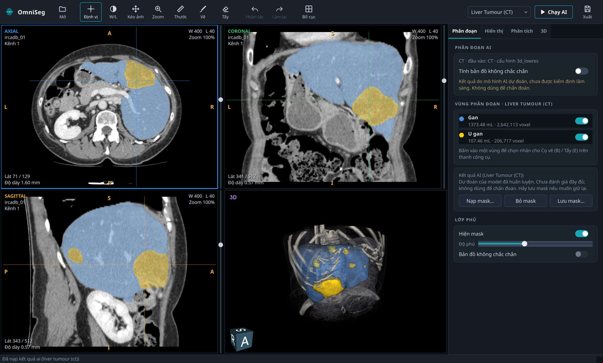
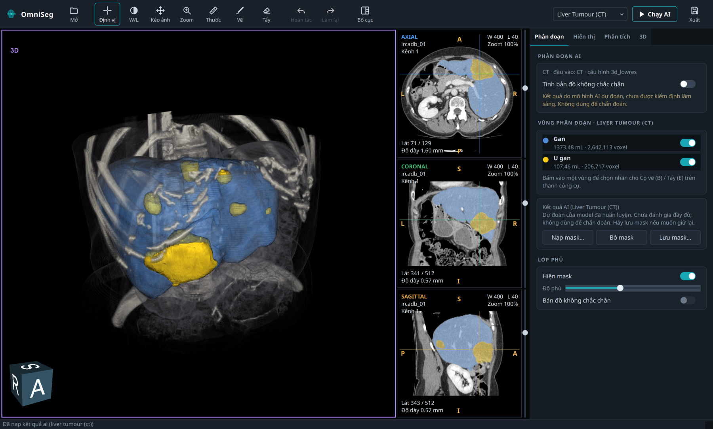
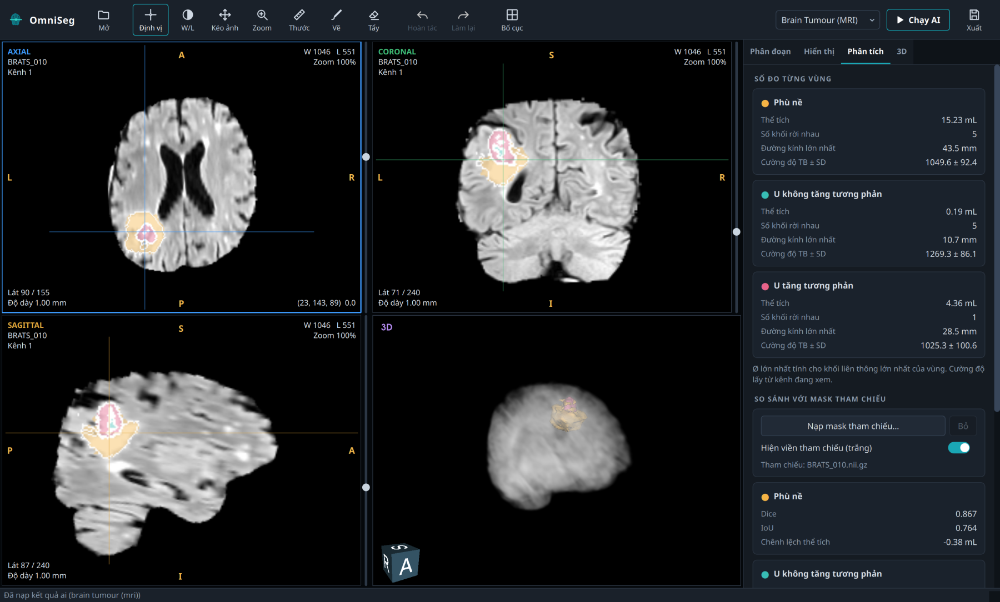
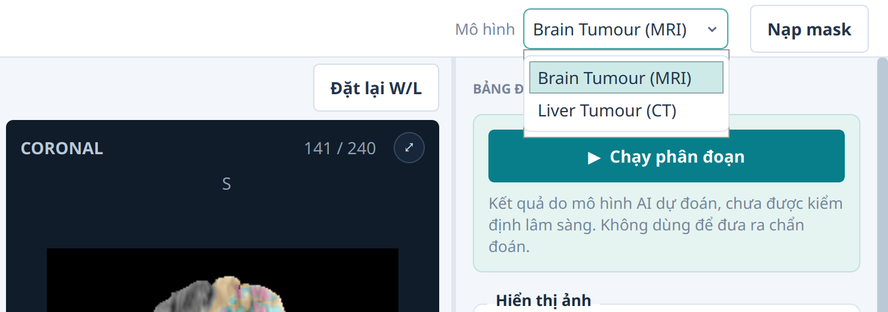

# OmniSeg

[Tiếng Việt](README.vi.md) · **English**

[](https://github.com/tranvanhuy-hichan/omniseg/actions/workflows/ci.yml)
[](LICENSE)


**OmniSeg** is an open-source desktop viewer and training scaffold for **multi-model medical image
segmentation** on NIfTI volumes, built on **nnU-Net v2 as a dependency**. It currently ships two trained
tasks, **brain tumour (MRI)** and **liver tumour (CT)**, selectable from a model dropdown. Each task is a folder
under [`tasks/`](tasks/README.md), so a new body region or modality is added without changing the app.
This is research software, not a clinical diagnostic system, and not a fork of nnU-Net.


*Brain Tumour (MRI): case `BRATS_010` from the fold-0 validation split. The three tumour regions were
predicted inside the app by the trained checkpoint (21 s on a laptop RTX 3050 4 GB). Four viewports with a
synchronised crosshair; the toolbar holds the tools (locate, window/level, pan, zoom, ruler, brush, eraser).*



*Liver Tumour (CT): case `ircadb_01` from the external [3D-IRCADb-01](docs/dataset-liver.md) set. Liver and lesion
were predicted inside the app (35 s on the same GPU), CT soft-tissue window. This image shows the interface and is
not evidence of accuracy.*

| Brain, 3D | Liver, 3D |
|---|---|
|  |  |

*3D view in the "1+3" layout (one large viewport, three small ones): mask surfaces over a faint rendering of the
image. In the liver image the predicted lesions (yellow) show through the semi-transparent liver surface (blue).*



*Analysis tab: for each region the volume, number of separate components, largest diameter and mean intensity of
the current mask, and Dice / IoU against a loaded reference mask (white outline on the slices). Here `BRATS_010`
is compared with its dataset label; Dice from one case is not an estimate of model accuracy, and this case was
visible to training-time monitoring.*



## Models

Every number below was read from the saved `plans.json`, `dataset.json`, the checkpoints, the training logs and
the installed nnU-Net 2.8.1 source, not from memory.

| | **Brain Tumour (MRI)** | **Liver Tumour (CT)** |
|---|---|---|
| Task id | `brain_tumour_mri` | `liver_tumour_ct` |
| Training data | MSD Task01_BrainTumour, release 2.0 (484 labelled cases) | MSD Task03_Liver, release 1.0 (131 labelled cases) |
| Input channels | 4, in this order: FLAIR, T1w, t1gd, T2w | 1: CT |
| Output classes | 4: background, edema, non-enhancing tumor, enhancing tumour | 3: background, liver, cancer |
| nnU-Net dataset / configuration | 501 / `3d_fullres` (ResEnc-M) | 502 / `3d_lowres` |
| Network | `PlainConvUNet`, 6 stages | `PlainConvUNet`, 6 stages |
| Features per stage | 32, 64, 128, 256, 512, 512 | 32, 64, 128, 256, 320, 320 |
| Convolutions | 3×3, strides 1,2,2,2,2,2, two per stage | 3×3×3, strides 1,2,2,2,2,2, two per stage |
| Normalisation / activation | InstanceNorm (affine), LeakyReLU, no dropout | InstanceNorm (affine), LeakyReLU, no dropout |
| Parameters | 58,370,292 | 88,621,199 |
| Patch size / batch size | 192×160 / 105 | 128×128×128 / 2 |
| Target spacing | 1.0 × 1.0 mm in plane | 2.50 mm along the slice axis, 1.92 × 1.92 mm in plane (median original spacing 1.0 × 0.77 × 0.77 mm) |
| Intensity normalisation | z-score per channel, computed inside the non-zero (brain) mask | CT scheme: clip to −15…197 HU (0.5th–99.5th percentile of foreground), subtract mean 99.48, divide by std 37.14 |
| Trainer | `nnUNetTrainer_100epochs` | `nnUNetTrainer_100epochs` |
| Schedule | 100 epochs × 250 training and 50 validation iterations | 100 epochs × 250 training and 50 validation iterations |
| Loss | Dice + cross-entropy, batch Dice on | Dice + cross-entropy, batch Dice off |
| Optimiser | SGD, momentum 0.99 (Nesterov), weight decay 3e-5 | same |
| Learning rate | 0.01, poly decay (exponent 0.9); 0.00016 in the last epoch | same |
| Fold trained | fold 0 of 5 case-level folds (seed 12345): 387 train / 97 validation | fold 0 of 5 case-level folds (seed 12345): 104 train / 27 validation |
| Epoch time | median about 195 s, about 5.0 h of epochs in total; accelerator not recorded | about 224 s, 6.2 h in total, Tesla T4 (the trainer used one of the two visible GPUs) |
| Final train / validation loss | −0.833 / −0.751 | −0.703 / −0.660 |
| Final-epoch pseudo-Dice (fold-0 validation) | edema 0.83, non-enhancing 0.73, enhancing 0.87 | liver 0.96, cancer 0.77 |

**Pseudo-Dice is not full-volume Dice.** It is the Dice that nnU-Net's trainer logs on sampled validation
patches during training. No full-volume evaluation has been run for either model yet.

**Shared training recipe** (nnU-Net defaults for this trainer). Deep supervision is on: the loss is applied to the
decoder outputs at several resolutions, each weighted half as much as the one above it, and the lowest-resolution
output gets zero weight. A third of each batch is oversampled to contain foreground. Augmentation is random
rotation (±180° for the 2D patch, ±30° for the 3D patch) and scaling 0.7–1.4, both with probability 0.2, plus Gaussian
noise, Gaussian blur, brightness, contrast, low-resolution simulation, gamma and mirroring.

**How the app runs a model.** The Run button calls `nnUNetv2_predict` with fold 0 and `checkpoint_final.pth`
(see `omniseg/core/inference.py` and the task's `task.json`), with nnU-Net's default inference settings:
sliding window with a step of half a patch and Gaussian weighting, and mirroring test-time augmentation over every
flip combination of the allowed axes (4 forward passes per window in 2D, 8 in 3D).

- **Brain (2D):** the volume is segmented one slice at a time, each slice along the first axis of nnU-Net's array
  (the NIfTI third axis), then the slices are stacked. A slice never sees its neighbours.
- **Liver (3d_lowres):** the volume is resampled to the low-resolution target spacing, segmented in 128³ windows, and
  the predicted probabilities are resampled back (linear interpolation) to the original grid before the final label
  is taken.

Measured on one laptop (RTX 3050 4 GB, nnU-Net 2.8.1), from clicking Run to the mask appearing: about 20 s for one
brain case, and 47–80 s for the four liver cases tried (74–105 slices). These are single timings, not benchmarks.

**Input requirements.** NIfTI (`.nii` or `.nii.gz`). Brain: a 4D file with the four channels in the order above (the
app checks the channel count; it cannot check the order). Liver: a 3D CT volume. nnU-Net resamples to the target
spacing itself; it does not reorient or register the image, so inputs should be in the same kind of orientation as
the MSD data.

**Not known or not measured.** Full-volume Dice, or any metric on data outside the training folds; behaviour on other
scanners, protocols or patient populations; the other four folds and any ensemble; which GPU the brain training used;
timings on other hardware. The 97 brain test cases are the fold-0 validation cases (none was in the fold-0 training
set), so they are held out from training but were visible to training-time monitoring. The 20-case
[3D-IRCADb-01](docs/dataset-liver.md) set is an external liver test set, but 5 of its cases have no tumour label
and no score on it has been computed yet.

## Quick start (desktop viewer)

Python 3.11 is the tested target. Bash is needed for the pipeline wrappers (Linux/macOS or WSL).

```bash
git clone https://github.com/tranvanhuy-hichan/omniseg.git
cd omniseg
uv venv --python 3.11 .venv
source .venv/bin/activate
uv pip install --torch-backend auto -r requirements.txt -r requirements-desktop.txt
python scripts/check_environment.py
python -m omniseg          # or: make desktop
```

Without `uv`, install the appropriate [PyTorch build](https://pytorch.org/get-started/locally/) first, then run
`python -m pip install -r requirements.txt -r requirements-desktop.txt`. The project pins nnU-Net 2.8.1.

1. Open an image with **Mở** in the toolbar (NIfTI file or DICOM folder), press **Ctrl+O**, or drag a file/folder into
   the window. The model matching the image's channel count is selected automatically.
2. Press **Chạy phân đoạn AI** (tick *Tính bản đồ không chắc chắn* first for a softmax-entropy map), or load a mask
   with **Nạp mask…**. The viewport banner always says when a mask is an unreviewed AI prediction.
3. Review and correct: **Cọ vẽ / Tẩy** (undo/redo), **Thước** for distances, the **Phân tích** tab for per-region
   volume, largest lesion diameter, intensity, and Dice/IoU against a loaded reference mask.
4. **Xuất** saves the mask (same orientation and affine as the opened image), exports meshes (STL/PLY/OBJ) or a
   CSV/JSON report.

Layout: four viewports (Axial, Coronal, Sagittal, 3D) with corner annotations and a synchronised crosshair; **2×2**,
**1+3** and **1×1** layouts (double-click a viewport). Mouse: wheel = slice, Ctrl+wheel = zoom, right-drag = window/level,
middle-drag = pan. Keys: V W P Z M B E select tools, `[` `]` brush size, 1/2/3 layouts, Esc leaves 1×1.
DICOM import needs `SimpleITK` (listed in `requirements-desktop.txt`).

**The trained checkpoints are not in this repository or in the release.** The Run button stays locked, with the
reason shown, until the checkpoint for the selected model exists at
`artifacts/nnUNet_results/<dataset>/nnUNetTrainer_100epochs__nnUNetPlans__<config>/fold_0/checkpoint_final.pth`
(together with that folder's `plans.json` and `dataset.json`). You can still open images and load masks without it.
To produce your own checkpoints, see [docs/kaggle-training.md](docs/kaggle-training.md) and the pipeline below.
Viewer details: [docs/desktop.md](docs/desktop.md).

Packaged desktop builds (attached to tagged releases, about 0.8 GB unpacked) are viewers: to run a model they also
need nnU-Net installed separately (`nnUNetv2_predict` on `PATH`) and the `nnUNet_results` environment variable
pointing at the folder that holds the checkpoints.

## Train your own model

`make` prints the available commands. The default environment is `~/venvs/ai`; override it with `VENV=/path/to/venv`.

```bash
make doctor          # report nnU-Net / PyTorch / CUDA versions
make check           # tests and shell syntax
make import-msd      # import the MSD Task01 archive (see docs/dataset.md)
make plan            # plan and preprocess
make train           # full training: dataset 501, 2d, fold 0
make predict INPUT=data/inference OUTPUT=artifacts/predictions
```

Use `DATASET=502 CONFIG=3d_lowres FOLD=0` to select another task, and `make resume` to continue training. Custom
datasets go through `scripts/prepare_dataset.py` (manifest examples in `configs/`): inputs must be 3D `.nii.gz`
files with matching geometry within a case, labels are never remapped silently, and each case ID must be one
independent patient (repeated scans need a custom grouped split). The first two models were trained on Kaggle
in two stages, CPU preprocessing then a budgeted GPU run: see
[docs/kaggle-training.md](docs/kaggle-training.md). Dataset notes: [brain](docs/dataset.md),
[liver](docs/dataset-liver.md).

## Adding a model

Copy `tasks/liver_tumour_ct/` as a template and follow [tasks/README.md](tasks/README.md): a `task.json`, the
dataset fingerprint and a short README. The app discovers the new task on its next start; no change to `omniseg/` is
needed. [docs/project-structure.md](docs/project-structure.md) describes every top-level folder and how to build the
standalone app (`make build-desktop`).

## Development

```bash
python -m pip install -r requirements-dev.txt
python -m pytest -q
bash -n scripts/env.sh scripts/pipeline.sh
```

Tests use synthetic data only (no nnU-Net, CUDA or patient data). CI runs the tests and shell syntax checks; it does
not train a model or establish medical accuracy. See [Contributing](CONTRIBUTING.md),
[Code of Conduct](CODE_OF_CONDUCT.md), [Security](SECURITY.md), [Architecture](docs/architecture.md) and
[Roadmap](docs/roadmap.md).

## Limitations and safety

- **Not a medical device.** Do not use any output to make or support a diagnosis or treatment decision. Predictions
  are labelled as AI results in the app and have no clinical validation.
- Each model is a single fold trained for 100 epochs, not the 1000-epoch nnU-Net default and not a five-fold ensemble.
- Only pseudo-Dice from training is reported, and none of it is full-volume or external; see *Not known or not
  measured* above.
- Geometry checks do not verify that a mask belongs to the same patient or that images are registered.
- Do not publish patient identifiers, scans, local manifests or credentials in issues, commits or screenshots.

## Data, credits and license

Datasets are not bundled and keep their own terms.

- **Medical Segmentation Decathlon**, Task01_BrainTumour (BraTS 2016–2017 data) and Task03_Liver:
  [CC BY-SA 4.0](https://creativecommons.org/licenses/by-sa/4.0/). Antonelli et al., *The Medical Segmentation
  Decathlon*, Nature Communications (2022), [doi:10.1038/s41467-022-30695-9](https://doi.org/10.1038/s41467-022-30695-9).
  The brain screenshots above contain slices of MSD case `BRATS_010` with model-predicted overlays and are shared
  under the same license with this attribution.
- **3D-IRCADb-01** (external liver test set): [CC BY-NC-ND 4.0](https://creativecommons.org/licenses/by-nc-nd/4.0/),
  non-commercial, and its data are not redistributed here. The only exception is the two liver screenshots above,
  which show slices of case `ircadb_01` with model-predicted overlays for illustration; they remain subject to
  that license (non-commercial use, attribution). Soler et al., *3D image reconstruction for comparison of algorithm
  database: a patient specific anatomical and medical image database*, IRCAD, Strasbourg, France, Tech. Rep. (2010).

Original project code is licensed **AGPL-3.0-or-later**. Dependencies keep their own licenses (nnU-Net is Apache-2.0);
see [LICENSE](LICENSE) and [third-party notices](THIRD_PARTY_NOTICES.md). Please cite nnU-Net when publishing work
based on it:

> Isensee et al. nnU-Net: a self-configuring method for deep learning-based biomedical image segmentation.
> Nature Methods (2021). [doi:10.1038/s41592-020-01008-z](https://doi.org/10.1038/s41592-020-01008-z).
