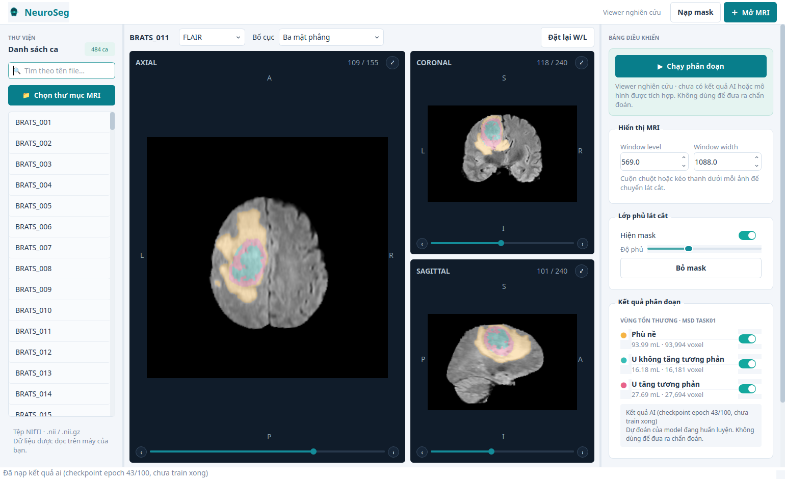

# NeuroSeg

[Tiếng Việt](README.vi.md) · **English**

[](https://github.com/tranvanhuy-hichan/brain-mri-segmentation/actions/workflows/ci.yml)
[](LICENSE)


**NeuroSeg** is an open-source research project for brain MRI tumor segmentation using **nnU-Net v2 as a dependency**.
The goal is a reproducible path from registered MRI volumes to segmentation masks, evaluation and 3D visualization.
This is an independent application scaffold, not a fork of nnU-Net or a clinical diagnostic system.



## Current scope

| Available | Planned |
|---|---|
| Multi-channel NIfTI dataset importer | Evaluation on a named real dataset |
| Geometry, label and duplicate-ID checks | Patient-grouped custom splits for longitudinal scans |
| Plan/preprocess, train and predict wrappers | Mask-to-mesh export and physical volume measurements |
| Native MRI slice/mask viewer and synthetic-data tests | 3D viewer and inference API |

No patient data, pretrained checkpoints or training results are included. A native slice viewer is available; MRI volume rendering and 3D mask surfaces are available; AI inference remains planned.

```text
Registered MRI volumes + masks
              ↓
Validate and import → nnU-Net planning → fold training → predicted masks
                                                         ↓
                                           evaluation / 3D viewer (planned)
```

## Quick start

Python 3.11 is the tested target; Bash is required for the pipeline wrappers (Linux/macOS or WSL).

```bash
git clone https://github.com/tranvanhuy-hichan/brain-mri-segmentation.git
cd brain-mri-segmentation
uv venv --python 3.11 .venv
source .venv/bin/activate
uv pip install --torch-backend auto -r requirements.txt
uv pip install -r requirements-dev.txt
python scripts/check_environment.py
```

Without `uv`, create a virtual environment and install the appropriate
[PyTorch build](https://pytorch.org/get-started/locally/) first, then run
`python -m pip install -r requirements.txt -r requirements-dev.txt`.
The project pins nnU-Net 2.8.1; GPU dependencies depend on your platform and driver.

### Makefile shortcuts

`make` prints available commands. The default environment is `~/venvs/ai`; no activation
or new environment is needed. Override it with `VENV=/path/to/venv`.
`make setup` requires `uv` and installs the training dependencies into that environment.
`make setup-dev` installs the development requirements and may change versions in a shared environment.

```bash
make doctor
make check
make init-config     # edit the local configs for your real dataset next
make prepare
make plan
make train           # full training: dataset 501, 2d, fold 0
make predict
```

Use `DATASET=501 CONFIG=3d_fullres FOLD=0` to select another configuration.
Use `make resume` to continue training, or `INPUT=... OUTPUT=...` for prediction paths.
These targets require real prepared data and trained weights where applicable.

### 1. Prepare a dataset

Place your licensed dataset in `data/source/` (ignored by Git), then edit local copies of the examples:

```bash
cp configs/dataset.example.json configs/dataset.local.json
cp configs/cases.example.json configs/cases.local.json
source scripts/env.sh
python scripts/prepare_dataset.py \
  --config configs/dataset.local.json \
  --manifest configs/cases.local.json
```

The example uses four channels in this order: **FLAIR, T1, T1ce, T2**. It expects a **binary mask**
(background=0, tumor=1). Adapt the configuration to your actual label convention. BraTS label conventions
vary by release; this importer deliberately does not merge or remap labels automatically.
Paths in the manifest are relative to the manifest file, or absolute.

All inputs must be 3D `.nii.gz` files with matching geometry within each case.
Geometry checks do not perform registration or verify anatomical alignment.
Existing destination datasets are never overwritten.

Each case ID must represent an independent patient. Repeated scans from the same patient need a
custom grouped split before training. Keep your independent test patients outside the training manifest.
The default five-fold split requires at least five cases; that minimum is not a sufficient study size.

### 2. Plan and train

```bash
scripts/pipeline.sh plan 501 2d
scripts/pipeline.sh train 501 2d 0 --npz
```

This launches full training for fold 0, not a short smoke test. Start with 2D to check the workflow;
3D memory requirements depend on the dataset and generated plan. A 4 GB GPU is not guaranteed to fit
an unmodified 3D plan. One fold is not a full five-fold cross-validation result.

To resume training, add `--c`. To use 3D, plan and train `3d_fullres` instead of `2d`.

### 3. Predict with the trained fold

```bash
scripts/pipeline.sh predict 501 2d 0 data/inference artifacts/predictions
```

Inference inputs must use the same channel order and `_0000.nii.gz`, `_0001.nii.gz`, … naming.
The wrapper explicitly selects the trained fold. It does not assume all five folds exist.

## Project layout

See [project-structure.md](docs/project-structure.md) for what each top-level folder
(`desktop/`, `scripts/`, `kaggle/`, `configs/`, `tests/`, `docs/`) is for, and how to
build the desktop app into a standalone executable.

To store large files elsewhere, export `nnUNet_raw`, `nnUNet_preprocessed` and `nnUNet_results`
before sourcing `scripts/env.sh`.

## Development

Tests require only the lightweight development dependencies, not nnU-Net, CUDA or real MRI data:

```bash
python -m pip install -r requirements-dev.txt
python -m pytest -q
bash -n scripts/env.sh scripts/pipeline.sh
```

CI validates the importer and shell syntax. It does **not** train a model or establish medical accuracy.
See [Contributing](CONTRIBUTING.md), [Code of Conduct](CODE_OF_CONDUCT.md),
[Security](SECURITY.md), [Architecture](docs/architecture.md) and [Roadmap](docs/roadmap.md).

## Data and limitations

Dataset access and redistribution are governed by the dataset provider's terms. No dataset is bundled.
Do not publish patient identifiers, scans, local manifests or credentials in issues, commits or screenshots.
Only de-identified, appropriately licensed synthetic/public examples should be shared.
No clinical performance has been measured in this repository.

## License and attribution

Original project code is licensed **AGPL-3.0-or-later**, following the author's Nestor Agent project.
Dependencies and datasets retain their own licenses; nnU-Net is independently licensed Apache-2.0.
See [LICENSE](LICENSE) and [third-party notices](THIRD_PARTY_NOTICES.md).

This project uses [nnU-Net](https://github.com/MIC-DKFZ/nnUNet). Please cite the upstream method
when publishing work based on it:

> Isensee et al. nnU-Net: a self-configuring method for deep learning-based biomedical image segmentation.
> Nature Methods (2021). [doi:10.1038/s41592-020-01008-z](https://doi.org/10.1038/s41592-020-01008-z).

Upstream references: [dataset format](https://github.com/MIC-DKFZ/nnUNet/blob/v2.8.1/documentation/dataset_format.md)
and [training/inference](https://github.com/MIC-DKFZ/nnUNet/blob/v2.8.1/documentation/how_to_use_nnunet.md).

## Selected dataset / Dataset đã chọn

The initial baseline uses **MSD Task01 BrainTumour (release 2.0)**, with 4 MRI channels and
labels 0=background, 1=edema, 2=non-enhancing tumor, 3=enhancing tumor.
See [dataset decision, download and evaluation plan](docs/dataset.md).
Use `make import-msd` for its 4D files; the earlier binary manifest example is for custom data only.

## Native desktop viewer

```bash
make setup-desktop
make desktop
```

View real NIfTI slices, MRI channels and separately loaded masks, or run the
current pilot checkpoint directly from the viewer.

See [desktop usage and limits](docs/desktop.md). VTK MRI volume rendering and 3D mask surfaces are available.
The "Run segmentation" button invokes the current pilot checkpoint (fold 0, trained the
full 100/100 epochs, not yet evaluated on held-out data) via `nnUNetv2_predict`;
its output is labeled as an AI result, never as a reference label.

## Kaggle training

CPU preprocessing and a budgeted 100-epoch 2D pilot are prepared in `kaggle/`.
See [Kaggle stages, quota, checkpoints and commands](docs/kaggle-training.md).
