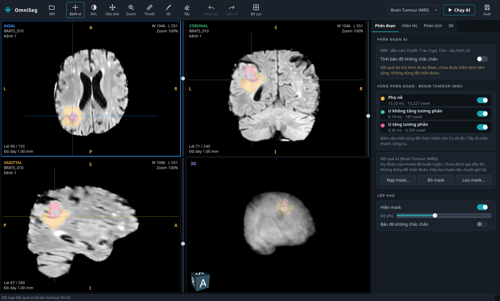
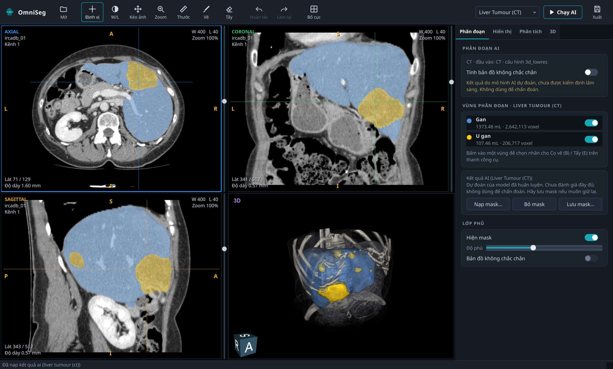
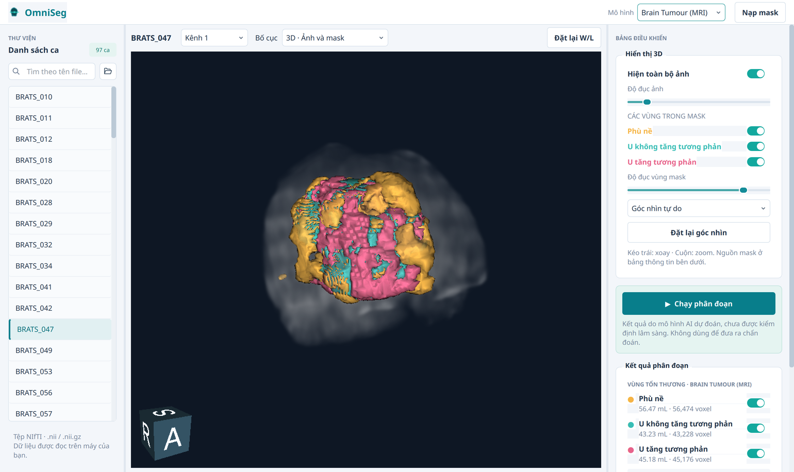
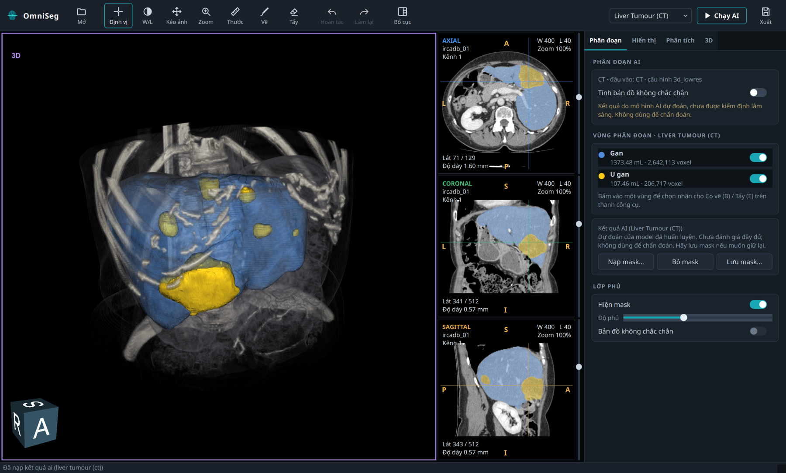
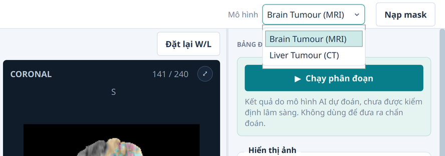

# OmniSeg

**Tiếng Việt** · [English](README.md)

[](https://github.com/tranvanhuy-hichan/omniseg/actions/workflows/ci.yml)
[](LICENSE)


**OmniSeg** là ứng dụng desktop mã nguồn mở kèm bộ khung huấn luyện cho **phân đoạn ảnh y khoa đa mô hình** trên
thể tích NIfTI, dùng **nnU-Net v2 như một dependency**. Hiện có hai task đã huấn luyện: **u não trên MRI** và
**u gan trên CT**, chọn bằng dropdown mô hình. Mỗi task là một thư mục trong [`tasks/`](tasks/README.md), nên thêm
vùng cơ thể hay modality mới không cần sửa app. Đây là phần mềm nghiên cứu, không phải công cụ chẩn đoán lâm sàng,
và không phải bản fork của nnU-Net.



*Brain Tumour (MRI): ca `BRATS_047` thuộc tập validation của fold 0. Ba vùng u được checkpoint đã huấn luyện dự
đoán ngay trong app (khoảng 20 giây trên laptop RTX 3050).*



*Liver Tumour (CT): ca `liver_77` thuộc tập validation của fold 0. Gan và tổn thương được dự đoán ngay trong app
(khoảng 56 giây trên cùng GPU). Tổn thương dự đoán nhỏ (4,5 mL); ảnh này minh họa giao diện, không phải bằng chứng
về độ chính xác.*

| Não, 3D | Gan, 3D |
|---|---|
|  |  |

*Chế độ 3D: bề mặt mask phủ trên bản dựng mờ của ảnh. Ở ảnh gan, tổn thương dự đoán nằm trong bề mặt gan bán trong
suốt nên bị che ở góc nhìn này.*



## Các mô hình

Mọi con số dưới đây đọc từ `plans.json`, `dataset.json`, checkpoint, log huấn luyện và mã nguồn nnU-Net 2.8.1 đã
cài, không viết theo trí nhớ.

| | **Brain Tumour (MRI)** | **Liver Tumour (CT)** |
|---|---|---|
| Task id | `brain_tumour_mri` | `liver_tumour_ct` |
| Dữ liệu huấn luyện | MSD Task01_BrainTumour, bản 2.0 (484 ca có nhãn) | MSD Task03_Liver, bản 1.0 (131 ca có nhãn) |
| Kênh đầu vào | 4, theo thứ tự: FLAIR, T1w, t1gd, T2w | 1: CT |
| Lớp đầu ra | 4: background, edema, non-enhancing tumor, enhancing tumour | 3: background, liver, cancer |
| Dataset / cấu hình nnU-Net | 501 / `2d` | 502 / `3d_lowres` |
| Mạng | `PlainConvUNet`, 6 stage | `PlainConvUNet`, 6 stage |
| Số feature mỗi stage | 32, 64, 128, 256, 512, 512 | 32, 64, 128, 256, 320, 320 |
| Tích chập | 3×3, stride 1,2,2,2,2,2, hai lớp mỗi stage | 3×3×3, stride 1,2,2,2,2,2, hai lớp mỗi stage |
| Chuẩn hoá / kích hoạt | InstanceNorm (affine), LeakyReLU, không dropout | InstanceNorm (affine), LeakyReLU, không dropout |
| Số tham số | 58.370.292 | 88.621.199 |
| Kích thước patch / batch | 192×160 / 105 | 128×128×128 / 2 |
| Spacing đích | 1,0 × 1,0 mm trong mặt phẳng | 2,50 mm theo trục lát cắt, 1,92 × 1,92 mm trong mặt phẳng (spacing gốc trung vị 1,0 × 0,77 × 0,77 mm) |
| Chuẩn hoá cường độ | z-score từng kênh, tính trong vùng khác 0 (não) | Kiểu CT: cắt về −15…197 HU (phân vị 0,5–99,5 của vùng tiền cảnh), trừ trung bình 99,48, chia độ lệch chuẩn 37,14 |
| Trainer | `nnUNetTrainer_100epochs` | `nnUNetTrainer_100epochs` |
| Lịch huấn luyện | 100 epoch × 250 bước train và 50 bước validation | 100 epoch × 250 bước train và 50 bước validation |
| Hàm loss | Dice + cross-entropy, bật batch Dice | Dice + cross-entropy, tắt batch Dice |
| Optimizer | SGD, momentum 0,99 (Nesterov), weight decay 3e-5 | giống |
| Learning rate | 0,01, giảm theo đa thức (số mũ 0,9); epoch cuối 0,00016 | giống |
| Fold đã train | fold 0 trong 5 fold chia theo ca (seed 12345): 387 train / 97 validation | fold 0 trong 5 fold chia theo ca (seed 12345): 104 train / 27 validation |
| Thời gian mỗi epoch | trung vị khoảng 195 giây, tổng khoảng 5,0 giờ; không ghi lại GPU | khoảng 224 giây, tổng 6,2 giờ, Tesla T4 (trainer dùng một trong hai GPU nhìn thấy) |
| Loss cuối (train / validation) | −0,833 / −0,751 | −0,703 / −0,660 |
| Pseudo-Dice epoch cuối (validation fold 0) | edema 0,83, non-enhancing 0,73, enhancing 0,87 | liver 0,96, cancer 0,77 |

**Pseudo-Dice không phải Dice toàn khối.** Đó là Dice mà trainer của nnU-Net ghi lại trên các patch validation được
lấy mẫu trong lúc huấn luyện. Chưa có đánh giá toàn khối nào cho cả hai mô hình.

**Công thức huấn luyện chung** (mặc định của nnU-Net cho trainer này). Deep supervision được bật: loss áp dụng cho
các đầu ra của decoder ở nhiều độ phân giải, mỗi mức có trọng số bằng một nửa mức trên nó, và đầu ra độ phân giải
thấp nhất có trọng số 0. Khoảng một phần ba mỗi batch được lấy mẫu để chắc chắn chứa tiền cảnh. Tăng cường dữ liệu
gồm xoay ngẫu nhiên (±180° cho patch 2D, ±30° cho patch 3D) và co giãn 0,7–1,4, cả hai với xác suất 0,2, cùng nhiễu
Gauss, làm mờ Gauss, độ sáng, tương phản, mô phỏng độ phân giải thấp, gamma và lật gương.

**Cách app chạy một mô hình.** Nút chạy gọi `nnUNetv2_predict` với fold 0 và `checkpoint_final.pth` (xem
`omniseg/core/inference.py` và `task.json` của task), dùng cài đặt suy luận mặc định của nnU-Net: cửa sổ trượt với
bước bằng nửa patch và trọng số Gauss, cùng test-time augmentation bằng lật gương theo mọi tổ hợp trục được phép
(4 lượt chạy mạng cho mỗi cửa sổ ở 2D, 8 lượt ở 3D).

- **Não (2D):** thể tích được phân đoạn từng lát một, mỗi lát theo trục đầu tiên của mảng nnU-Net (trục thứ ba của
  NIfTI), rồi xếp chồng lại. Một lát không nhìn thấy các lát bên cạnh.
- **Gan (3d_lowres):** thể tích được lấy mẫu lại về spacing đích độ phân giải thấp, phân đoạn bằng cửa sổ 128³, rồi
  xác suất dự đoán được lấy mẫu lại (nội suy tuyến tính) về lưới gốc trước khi chọn nhãn cuối cùng.

Đo trên một laptop (RTX 3050 4 GB, nnU-Net 2.8.1), từ lúc bấm chạy đến khi mask hiện ra: khoảng 20 giây cho một ca
não, và 47–80 giây cho bốn ca gan đã thử (74–105 lát). Đây là các lần đo đơn lẻ, không phải benchmark.

**Yêu cầu đầu vào.** NIfTI (`.nii` hoặc `.nii.gz`). Não: file 4D với bốn kênh đúng thứ tự trên (app chỉ kiểm tra số
kênh, không kiểm tra được thứ tự). Gan: thể tích CT 3D. nnU-Net tự lấy mẫu lại về spacing đích; nó không đổi hướng
hay đăng ký ảnh, nên đầu vào cần có hướng giống dữ liệu MSD.

**Chưa biết hoặc chưa đo.** Dice toàn khối, hoặc bất kỳ chỉ số nào trên dữ liệu ngoài các fold huấn luyện; hành vi
trên máy chụp, giao thức hay nhóm bệnh nhân khác; bốn fold còn lại và mọi ensemble; GPU đã dùng khi train mô hình
não; thời gian trên phần cứng khác. 97 ca test của não là các ca validation của fold 0 (không ca nào nằm trong tập
train của fold 0), nên chúng được giữ ngoài huấn luyện nhưng đã được theo dõi trong lúc train. Bộ
[3D-IRCADb-01](docs/dataset-liver.md) 20 ca là tập test gan bên ngoài, nhưng 5 ca không có nhãn u và chưa tính điểm
nào trên đó.

## Chạy nhanh (viewer desktop)

Python 3.11 là bản được kiểm thử. Cần Bash cho các wrapper pipeline (Linux/macOS hoặc WSL).

```bash
git clone https://github.com/tranvanhuy-hichan/omniseg.git
cd omniseg
uv venv --python 3.11 .venv
source .venv/bin/activate
uv pip install --torch-backend auto -r requirements.txt -r requirements-desktop.txt
python scripts/check_environment.py
python -m omniseg          # hoặc: make desktop
```

Nếu không dùng `uv`, cài trước bản [PyTorch](https://pytorch.org/get-started/locally/) phù hợp, rồi chạy
`python -m pip install -r requirements.txt -r requirements-desktop.txt`. Dự án ghim nnU-Net 2.8.1.

1. Mở ảnh bằng icon thư mục cạnh ô tìm kiếm (menu cho chọn một ảnh hoặc cả thư mục), hoặc nhấn **Ctrl+O**.
2. Chọn mô hình ở dropdown **Mô hình** trên header.
3. Bấm **Chạy phân đoạn**, hoặc nạp mask bằng **Nạp mask**. Panel luôn ghi rõ mask là dự đoán của mô hình hay nhãn
   tham chiếu.

**Checkpoint đã huấn luyện không nằm trong repo hay bản release.** Nút chạy bị khoá, kèm lý do, cho đến khi có
checkpoint của mô hình đang chọn tại
`artifacts/nnUNet_results/<dataset>/nnUNetTrainer_100epochs__nnUNetPlans__<config>/fold_0/checkpoint_final.pth`
(cùng `plans.json` và `dataset.json` trong thư mục đó). Không có checkpoint vẫn mở được ảnh và nạp mask. Để tạo
checkpoint của riêng bạn, xem [docs/kaggle-training.md](docs/kaggle-training.md) và pipeline bên dưới. Chi tiết
viewer: [docs/desktop.md](docs/desktop.md).

Bản đóng gói desktop (đính kèm các release có gắn tag, khoảng 0,8 GB khi giải nén) chỉ là viewer: để chạy mô hình
còn cần cài nnU-Net riêng (`nnUNetv2_predict` nằm trong `PATH`) và đặt biến môi trường `nnUNet_results` trỏ tới thư
mục chứa checkpoint.

## Tự huấn luyện mô hình

`make` in ra danh sách lệnh. Môi trường mặc định là `~/venvs/ai`; đổi bằng `VENV=/duong/dan/venv`.

```bash
make doctor          # báo phiên bản nnU-Net / PyTorch / CUDA
make check           # test và kiểm tra cú pháp shell
make import-msd      # nhập archive MSD Task01 (xem docs/dataset.md)
make plan            # plan và preprocess
make train           # train đầy đủ: dataset 501, 2d, fold 0
make predict INPUT=data/inference OUTPUT=artifacts/predictions
```

Dùng `DATASET=502 CONFIG=3d_lowres FOLD=0` để chọn task khác, và `make resume` để tiếp tục huấn luyện. Dataset tự
chuẩn bị đi qua `scripts/prepare_dataset.py` (manifest mẫu trong `configs/`): đầu vào phải là `.nii.gz` 3D có
geometry khớp trong từng ca, nhãn không bao giờ bị đổi ngầm, và mỗi ID ca phải là một bệnh nhân độc lập (nhiều lần
chụp của cùng người cần split theo bệnh nhân). Hai mô hình đầu tiên được train trên Kaggle theo hai giai đoạn, CPU
preprocess rồi chạy GPU có giới hạn thời gian: xem [docs/kaggle-training.md](docs/kaggle-training.md). Ghi chú
dataset: [não](docs/dataset.md), [gan](docs/dataset-liver.md).

## Thêm mô hình mới

Sao chép `tasks/liver_tumour_ct/` làm mẫu và làm theo [tasks/README.md](tasks/README.md): một `task.json`, dataset
fingerprint và một README ngắn. App tự nhận task mới ở lần khởi động kế tiếp; không cần sửa `omniseg/`.
[docs/project-structure.md](docs/project-structure.md) (tiếng Anh) mô tả từng thư mục gốc và cách đóng gói app độc
lập (`make build-desktop`).

## Phát triển

```bash
python -m pip install -r requirements-dev.txt
python -m pytest -q
bash -n scripts/env.sh scripts/pipeline.sh
```

Test chỉ dùng dữ liệu tổng hợp (không cần nnU-Net, CUDA hay dữ liệu bệnh nhân). CI chạy test và kiểm tra cú pháp
shell; nó không huấn luyện mô hình và không xác nhận độ chính xác y khoa. Xem [hướng dẫn đóng góp](CONTRIBUTING.md),
[quy tắc ứng xử](CODE_OF_CONDUCT.md), [báo lỗi bảo mật](SECURITY.md), [kiến trúc](docs/architecture.md) và
[lộ trình](docs/roadmap.md).

## Giới hạn và an toàn

- **Không phải thiết bị y tế.** Không dùng bất kỳ kết quả nào để chẩn đoán hay ra quyết định điều trị. Dự đoán được
  gắn nhãn là kết quả AI trong app và chưa được kiểm định lâm sàng.
- Mỗi mô hình chỉ là một fold huấn luyện 100 epoch, không phải 1000 epoch mặc định của nnU-Net và không phải
  ensemble năm fold.
- Chỉ báo cáo pseudo-Dice lúc huấn luyện, không phải toàn khối hay đánh giá ngoài; xem mục *Chưa biết hoặc chưa đo*
  ở trên.
- Kiểm tra geometry không xác nhận mask thuộc cùng bệnh nhân hay ảnh đã được đăng ký.
- Không đưa mã định danh bệnh nhân, ảnh chụp, manifest cục bộ hay thông tin xác thực vào issue, commit hoặc ảnh chụp
  màn hình.

## Dữ liệu, ghi công và giấy phép

Dataset không được đóng kèm và giữ điều khoản riêng.

- **Medical Segmentation Decathlon**, Task01_BrainTumour (dữ liệu BraTS 2016–2017) và Task03_Liver:
  [CC BY-SA 4.0](https://creativecommons.org/licenses/by-sa/4.0/). Antonelli et al., *The Medical Segmentation
  Decathlon*, Nature Communications (2022), [doi:10.1038/s41467-022-30695-9](https://doi.org/10.1038/s41467-022-30695-9).
  Các ảnh chụp màn hình ở trên chứa lát cắt của ca MSD `BRATS_047` và `liver_77` cùng lớp phủ do mô hình dự đoán,
  được chia sẻ theo cùng giấy phép với ghi công này.
- **3D-IRCADb-01** (tập test gan bên ngoài): [CC BY-NC-ND 4.0](https://creativecommons.org/licenses/by-nc-nd/4.0/),
  chỉ phi thương mại, không được phân phối lại ở đây. Soler et al., *3D image reconstruction for comparison of
  algorithm database: a patient specific anatomical and medical image database*, IRCAD, Strasbourg, France, Tech.
  Rep. (2010).

Code gốc dùng [AGPL-3.0-or-later](LICENSE). Các dependency giữ giấy phép riêng (nnU-Net là Apache-2.0); xem
[LICENSE](LICENSE) và [thông báo bên thứ ba](THIRD_PARTY_NOTICES.md). Hãy trích dẫn nnU-Net khi công bố công trình
dựa trên nó:

> Isensee et al. nnU-Net: a self-configuring method for deep learning-based biomedical image segmentation.
> Nature Methods (2021). [doi:10.1038/s41592-020-01008-z](https://doi.org/10.1038/s41592-020-01008-z).
